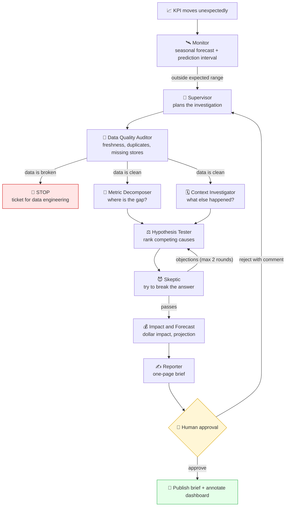
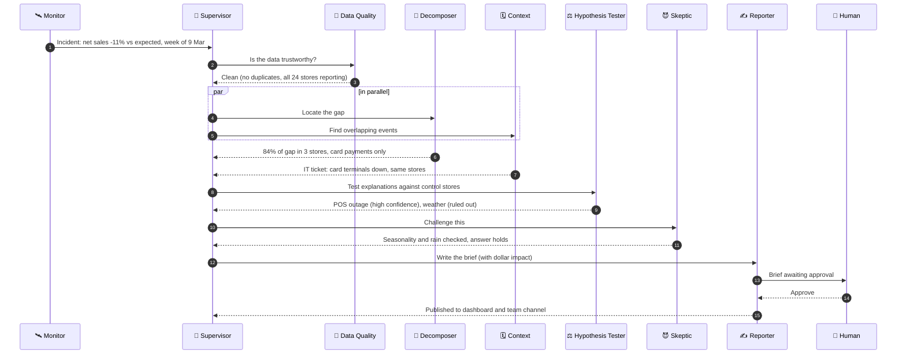
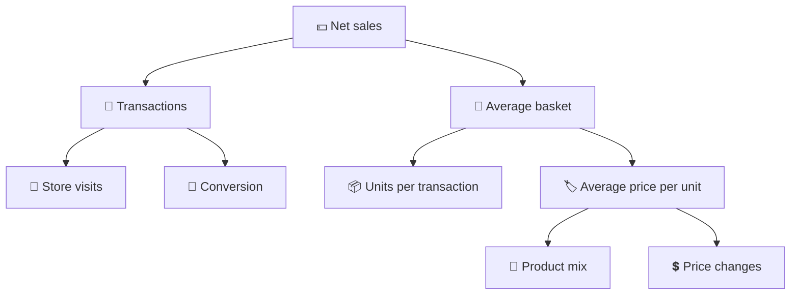
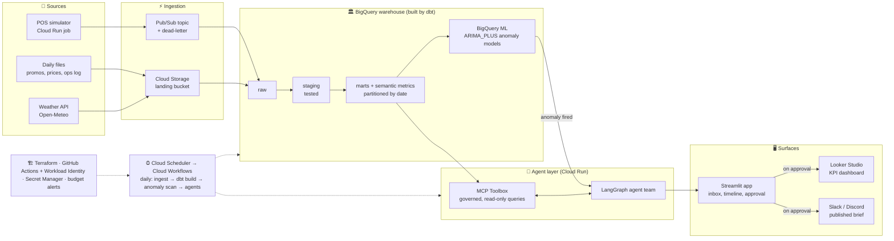
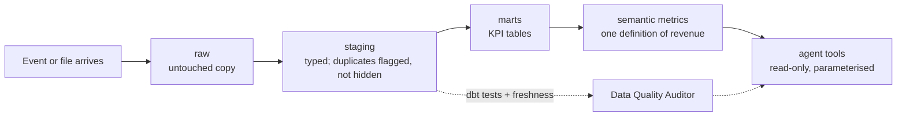
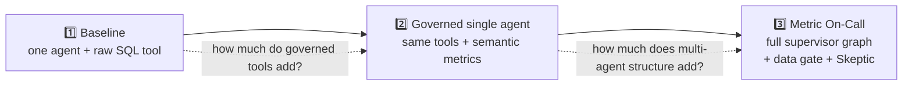
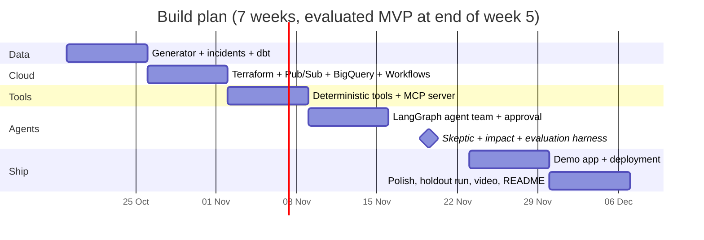

<div align="center">

# 🚨 Metric On-Call

### A team of AI agents that explains *why the number moved*, then proves it.

**Multi-agent root-cause analysis for business KPIs, built on a Google Cloud data platform.**
Data engineering · analytics engineering · BI · machine learning · AI agents, in one project.


</div>

---

## 📌 Project status

> **v0.1 is built.** The data generator, deterministic tools, MCP server, agent team and
> evaluation harness exist and are covered by an offline test suite (`make test`). What is **not**
> yet measured: LLM-backed agents (Ollama/Gemini). The numbers in `evals/results/` are for the
> offline *scripted* pipeline, which uses the same governed tools but no language model. Treat the
> LLM evaluation targets below as targets until `make eval-llm` has been run.

| Component | State |
| --- | --- |
| Architecture, agent design, incident catalogue, eval plan | ✅ Done |
| Synthetic data generator + 13 seeded incidents with counterfactual truth | ✅ Built, tested |
| Deterministic analysis tools + read-only MCP server | ✅ Built, tested |
| Agent team (supervisor graph, skeptic loop, approval gate) | ✅ Built, tested offline; LangGraph graph written, run in CI |
| Evaluation harness (scripted, naive baseline) | ✅ Built; LLM configs ⏳ |
| dbt models + tests | 🟡 Written, not yet run end to end |
| Google Cloud deployment (Terraform): BigQuery `raw` + `analytics`, landing bucket, nightly loader job, one-command deploy | ✅ Deployed and verified: all 12 tables loaded, offline eval reproduced reading from BigQuery |
| Pub/Sub streaming, Cloud Workflows, agents hosted on Cloud Run | ⏳ Not built yet |
| Streamlit app | 🟡 Written, not yet run |
| Web portal (dashboard, live pipeline, per-agent output, tasks, approval) | 🟡 Written; unit-tested in isolation; first full run on your machine pending |

---

## 🖥️ The portal (manual, on-demand runs)

A local web app that shows the whole process: the agent pipeline lighting up step by step, every agent's output and
tool calls, a KPI dashboard, a task board, and the human approval step. **Nothing runs on a schedule** (the nightly
trigger is off by default); an investigation starts only when someone clicks **Run**, so it never burns cloud credits.

```bash
make portal          # local DuckDB data, opens http://127.0.0.1:8765
make portal-cloud    # same UI, reading the BigQuery dataset (after `gcloud auth application-default login`)
```

Pick a planted incident, choose the brain (Offline baseline, Ollama or Gemini) and a pace, press Run, then approve or reject
the brief. "Reveal planted ground truth" compares the agents' answer with what the generator really did.

## 🧨 The problem

Every Monday someone asks: **"Why did sales drop last week?"**

An analyst then loses half a day: slicing by store, product, channel and payment type,
checking the promo calendar, wondering whether the pipeline broke, and finally writing
it up. Often they skip the first check (*is the data even right?*) and present a
broken load as a business problem.

**Metric On-Call automates that whole investigation** the way a careful senior analyst
would run it, and keeps a human in charge of what gets published.

---

## ✨ What it does

1. **Watches** every KPI against a seasonal forecast and flags real deviations.
2. **Audits the data first.** If the pipeline is broken, it stops and raises a ticket
   instead of inventing a business story.
3. **Locates the gap** by walking a metric tree (mix vs rate) across stores, regions,
   channels, categories and dayparts.
4. **Checks context**: promos, price changes, IT outages, store events, holidays, weather.
5. **Tests competing explanations** with control-store difference-in-differences.
6. **Attacks its own answer** with a Skeptic agent before anyone sees it.
7. **Sizes the damage** in dollars with a counterfactual and a month-end projection.
8. **Writes a one-page brief** and waits for **human approval** before publishing.

> **Design principle: deterministic tools do the maths, agents do the judgment.**
> Anomaly scores, decompositions and significance tests are plain, unit-tested Python
> and SQL. The LLMs choose which tool to call next, weigh explanations and write for the
> reader. That is what makes the numbers trustworthy.

---

## 🔄 How an investigation flows



### Who talks to whom



*(Illustrative walk-through of the seeded "card-terminal outage" incident. The figures are examples, not results.)*

---

## 🤖 The agent team

| # | Agent | The analyst step it replaces | Tools it uses |
| --- | --- | --- | --- |
| 0 | **Monitor** *(no LLM)* | Notice the number moved more than normal | Seasonal forecast, prediction intervals |
| 1 | **Supervisor** | Plan the work, route, know when to stop | Routing logic, step and cost budget |
| 2 | **Data Quality Auditor** | "Before we panic, is the data right?" | dbt tests, freshness, row-count, duplicate-ID, null-spike checks |
| 3 | **Metric Decomposer** | Break the KPI down until the gap is located | Metric-tree walk, mix-vs-rate decomposition, ranked drill-down |
| 4 | **Context Investigator** | Check what else happened that week | Promo, price, ops, store-event, holiday and weather lookups |
| 5 | **Hypothesis Tester** | Form competing explanations and test them | Control-store diff-in-diff, pre/post tests, cannibalisation check |
| 6 | **Skeptic** | Break the answer before a stakeholder does | Seasonality check, Simpson's-paradox check, $ reconciliation |
| 7 | **Impact and Forecast** | "So what is it costing us?" | Counterfactual vs actual, month-end projection |
| 8 | **Reporter** | Write it for the reader | Brief template, dashboard annotation, channel message |
| 9 | **Human approver** | Decide what the business sees | Approve, edit or reject with a comment |

### The metric tree the agents reason over



---

## ☁️ Architecture

The same code runs **locally** (DuckDB, free, offline) or on **Google Cloud**
(BigQuery, Pub/Sub, Cloud Run), switched by a config flag.



### Data lifecycle



---

## 🧪 The dataset: a fictional chain with planted incidents

**Harbour Lane Café & Grocer**: 24 stores across six Sydney regions, 18 months of daily
trading, generated by a seeded Python script (same seed, same data, every time).

Because *I* plant the incidents, *I* know the true cause. That is what makes the agents
measurable instead of merely impressive.

| # | Incident planted | True root cause | Difficulty |
| --- | --- | --- | --- |
| 1 | Card payments collapse at 3 Western Sydney stores for 2 days | POS outage | Medium |
| 2 | One day loaded twice for 5 stores | Pipeline bug, not a sales spike | Easy |
| 3 | Last 2 days missing for one region | Freshness failure, not a sales drop | Easy |
| 4 | 2-for-1 muffins lifts muffins, drains croissants | Promo cannibalisation | Hard |
| 5 | Large coffee +$0.50, size mix shifts | Price change (mix vs rate) | Medium |
| 6 | Slow decline at 2 stores, nothing logged anywhere | External cause: agents must say "not in our data" | Hard |
| 7 | Heavy rain week, visits fall everywhere | Weather, no action needed | Easy |
| 8 | Easter moves weeks, year-on-year looks awful | Calendar false alarm | Medium |
| 9 | Oat-milk supplier shortfall | Stockout | Medium |
| 10 | Delivery channel drops to zero for a day | Partner integration down | Easy |
| 11 | One store closed 5 days for refurbishment | Planned closure, no action | Easy |
| 12 | Basket rises overall, falls in every region | Simpson's paradox (mix shift) | Hard |
| 13 | Rain and a card outage in the same week | Two causes, split the impact | Hard |

Plus **10 quiet weeks** with no incident, to measure false alarms. Four incidents are
**held out** and never used for prompt tuning.

---

## 📏 Evaluation plan

> The headline of this project is not "it uses agents." It is **"here is how I know it works."**

Every investigation ends in a structured `findings` object (cause category, affected
segments, dollar impact, confidence) that is compared automatically to ground truth.

**Three configurations, three runs each:**



Configuration 3 is run on both a **free local model (Ollama on a MacBook M2)** and a
**Gemini Flash** model, to answer: *can a free laptop model do this job, and where does it break?*

| Metric | How it is measured | Target (goal, not a result) |
| --- | --- | --- |
| Root-cause accuracy, top-1 | Cause and main segment match ground truth | ≥ 80% (hard incidents reported separately) |
| Root-cause accuracy, top-3 | True cause among ranked hypotheses | ≥ 90% |
| Data-incident catch rate | Incidents 2 and 3 stopped at the data gate | 100% |
| False-alarm rate | Quiet weeks with an incident raised or cause invented | ≤ 1 in 10 |
| Honest "I don't know" | Incident 6 labelled external/unknown | Pass in all runs |
| Dollar-impact error | % error vs planted impact | Within ±15% |
| Consistency | Same answer across 3 runs | ≥ 2 of 3 agree |
| Brief quality | LLM judge, 1–5 rubric, spot-checked by hand | Mean ≥ 4 |
| Cost and latency | Tokens, time per investigation from traces | Report the number |

**Results:** *to be added in `evals/results/` once the harness has run.*

---

## 🧰 Tech stack

| Layer | Choice | Why |
| --- | --- | --- |
| Agent orchestration | **LangGraph** | The workflow is a graph with branches, loops, parallel steps and a human pause |
| Tool interface | **MCP** (Python SDK) + **MCP Toolbox for Databases** | Open standard for giving agents governed access to data |
| Warehouse | **BigQuery** (cloud) / **DuckDB** (local) | Cloud-scale and laptop-scale from the same code |
| Transformation | **dbt Core** | Tested, versioned, documented models; semantic metrics |
| Streaming | **Pub/Sub** with BigQuery subscription | Real-time ingestion without paying for Dataflow |
| Orchestration | **Cloud Scheduler + Cloud Workflows** (Airflow DAG included) | Dependencies, retries, idempotent backfills |
| Anomaly detection and forecasting | **BigQuery ML** `ARIMA_PLUS` (statsmodels locally) | Time-series ML inside the warehouse |
| Models | **Ollama** (local) · **Gemini API free tier** | ₹0 by default, switchable in one config |
| Observability | **Langfuse** | Trace every agent step and tool call |
| App and BI | **Streamlit** · **Looker Studio** | Incident console and executive dashboard |
| Infrastructure | **Terraform** · **GitHub Actions** + Workload Identity | Reproducible, keyless deployment |

---

## 💸 Free by design

Everything runs at **₹0**: open-source tools, Google Cloud's Always Free tiers, free
Gemini API or a local model. Deliberate cost choices (each one is a design decision):

- **Cloud Workflows instead of Cloud Composer**, because Composer bills around the clock.
- **Pub/Sub → BigQuery subscription instead of Dataflow**, since a few thousand events a day do not need it.
- **Scale-to-zero Cloud Run** and **partitioned, clustered tables** with byte caps on every query.
- **Replay mode** for the public demo (no model calls), **Live mode** with a visitor's own free key.
- **Budget alerts** and `terraform destroy` between demo days.

---

## 📁 Repository structure

```text
metric-on-call/
├── README.md
├── Makefile                 # make data | test | eval | demo | deploy
├── infra/                   # Terraform: BigQuery, GCS, Pub/Sub, Cloud Run, Workflows, IAM, budgets
├── generator/               # seeded synthetic data + incidents.yaml (ground truth)
├── pipelines/
│   ├── pos_simulator/       # publishes store events to Pub/Sub
│   ├── loaders/             # files and weather API → GCS → BigQuery
│   ├── workflows/           # Cloud Workflows daily run
│   └── airflow/             # equivalent Airflow DAG (local Docker)
├── warehouse/               # dbt project: staging, marts, semantic metrics, ML, tests
├── tools/                   # deterministic, unit-tested analysis tools + MCP server
├── agents/                  # LangGraph state, graph, one file per agent, versioned prompts
├── evals/                   # harness, baselines, judge rubric, committed results
├── app/                     # Streamlit app, Dockerfile, recorded replays
├── bi/                      # Looker Studio link and screenshots
├── docs/                    # diagrams, decisions.md, cost.md
└── .github/workflows/       # CI (dbt build, tests, eval smoke) and deploy
```

---

## 🚀 Quickstart

```bash
git clone https://github.com/<your-username>/metric-on-call.git
cd metric-on-call
uv sync

make data      # generate synthetic chain + planted incidents (DuckDB)
make test      # unit tests for every analysis tool
make demo      # Streamlit app in Replay mode, no API key needed

# optional: run the agents with a free local model
ollama pull qwen3.5:9b
MODEL_PROVIDER=ollama make eval-llm

# optional: deploy to your own Google Cloud project
make cloud-up  # terraform apply
```

---

## 🗺️ Roadmap



- [x] Architecture and design
- [ ] v0.1: data generator, dbt models, first agents on one incident, local mode
- [ ] v0.2: full agent team, 13 incidents, evaluation harness
- [ ] v0.3: Google Cloud deployment, Replay and Live demo
- [ ] v1.0: published eval results, demo video

**Stretch ideas:** follow-up questions on a brief, a weekly digest, real Slack delivery,
a "plant your own incident" demo, an A/B-test readout agent team on the same platform.

---

## 🧠 Design decisions

1. **Agents never write free-form SQL.** They call governed, parameterised tools, so
   "revenue" means one thing and a hallucinated query cannot run.
2. **Data quality comes first.** A pipeline bug must never become a business story.
3. **A Skeptic with a hard cap (2 rounds).** Challenge improves answers; unlimited
   challenge loops forever.
4. **A human approves before anything is published.** Agents propose, people decide.
5. **Synthetic data on purpose.** Planted causes make accuracy *measurable*.
6. **Local-first, cloud-optional.** Anyone can clone and run it without a cloud account.

## ⚠️ Limitations (stated honestly)

- Data is synthetic. It proves the method, not performance on a real company's data.
- Planted incidents are cleaner than reality; overlapping and unlogged causes are included to narrow that gap, not close it.
- Small local models are less reliable at tool calling than frontier models. The deterministic tool layer exists partly for this reason, and the eval reports the gap.
- Free-tier limits constrain run volume; Replay mode keeps the public demo reliable.

---

## 🎯 Skills this project demonstrates

| Role | Where to look |
| --- | --- |
| **Business analyst** | Stakeholder problem framing, metric trees, one-page briefs, approval workflow |
| **Data analyst** | Drill-down decomposition, mix-vs-rate, Simpson's paradox and Easter traps |
| **Data scientist** | Seasonal anomaly models, difference-in-differences, counterfactual impact, evaluation design |
| **BI developer** | Semantic layer, governed metrics, annotated dashboards |
| **Analytics engineer** | dbt models, tests, freshness checks, CI |
| **Data engineer** | Pub/Sub streaming, BigQuery partitioning, Workflows orchestration, Terraform, cost control |
| **AI / agent engineer** | LangGraph supervisor design, MCP tools, human-in-the-loop, tracing, ablation evals |

---

## 👤 Author

**Nivedha Murugan** · Master of Business Analytics, Macquarie University · ex backend software engineer
[LinkedIn](https://www.linkedin.com/in/your-profile) · [Email](mailto:you@example.com)

## 📄 License

MIT
